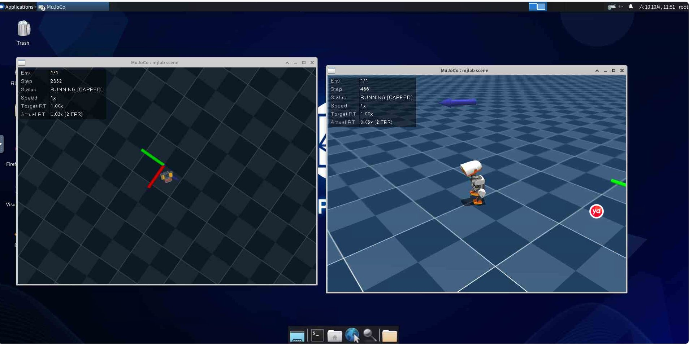

# 从零训练一只会走路的机器人鸭子：Microduck 强化学习实战全记录

> 用一台云 GPU、一条命令、一个下午，亲手把一只"一出生就摔"的仿真机器人，训练成能稳稳走路的双足鸭子。

**📦 本文已发布为 GitHub 仓库：[rio888414/Microduck-RL](https://github.com/rio888414/Microduck-RL)**

---

## 🚀 先玩为敬：官方在线沙盒

**不用装任何东西，打开网页就能玩这只机器鸭**（MuJoCo 物理引擎跑在浏览器里）：

### 👉 [https://huggingface.co/spaces/pollen-robotics/microduck-simulator](https://huggingface.co/spaces/pollen-robotics/microduck-simulator)

进去就能拖拽摄像机、下达速度命令、看鸭子走路/踢球/前滚翻。**建议先花 2 分钟玩一下**，建立对"具身智能"的直觉——你会更有动力看懂后面怎么亲手训练出这套策略。

<sub>💡 本文的全部训练成果，最终目标就是复现这个网页里的效果。它是纯前端静态页面（WebAssembly + onnxruntime-web），无需登录、无需 GPU。</sub>

---

## 写在前面：这篇写给谁

如果你对**具身智能（Embodied AI）**、**强化学习（RL）**、**Sim2Real** 这些词感兴趣，但一直觉得门槛太高——这篇文章就是写给你的。

不需要你有 GPU，不需要你懂强化学习，甚至不需要你买机器人。**一台云 GPU + 一个下午**，你就能亲眼看到一只机器鸭从走路摔跤到健步如飞的全过程。

全文分四部分：

| 章节      | 内容                    | 适合谁  |
| ------- | --------------------- | ---- |
| 一、背景与目标 | Microduck 是什么，我们要复现什么 | 所有人  |
| 二、知识点速通 | 看懂后面的技术名词             | 新手必读 |
| 三、保姆级实战 | 从租卡到看到鸭子走路            | 动手党  |
|         |                       |      |

---

## 一、背景与目标

### 1.1 Microduck 是什么

**Microduck** 是 Hugging Face 与 Pollen Robotics 联合推出的开源双足机器人——一只 25 厘米高、约 800 克重的"机械鸭"，售价 399 美元：

- **15 个电机**分布在腿、躯干、头部和喙
- 喙可以开合，能当夹爪用，能叼起约 800 克物体
- 传感器齐全：广角摄像头、LiDAR、双 IMU、麦克风、扬声器、NFC、Wi-Fi、蓝牙
- **出厂自带 7 种行为**：走路、下蹲、坐下、跌倒恢复、踢球、叼取、轮滑

但比硬件更有意思的是它的**软件哲学**——整套强化学习训练栈完全开源（Apache-2.0），你可以自己训练新技能：

> 在仿真里学（MuJoCo + PPO），训练好了再部署到真机上跑（50Hz）。

它的官方训练仓库 [`pollen-robotics/microduck_rl`](https://github.com/pollen-robotics/microduck_rl) 就是我们要用的主角。

### 1.2 本文目标

**最小目标**：在云 GPU 上训练一个"平地走路"（`Mjlab-Velocity-Flat-MicroDuck`）策略，并**亲眼看到鸭子走起来**。

**最终效果参照**：官方有一个浏览器沙盒（Microduck Sandbox），打开网页就能玩鸭子——MuJoCo 物理引擎编译成 WebAssembly、策略网络用 `onnxruntime-web` 跑，**全部在浏览器标签页内执行，不需要 GPU、不需要服务器推理**。

> ### 🎯 官方沙盒地址（本文的目标效果）
>
> **<https://huggingface.co/spaces/pollen-robotics/microduck-simulator>**
>
> 建议现在就打开看一眼——**后面所有折腾，都是为了亲手复现出这个网页里那只走得稳稳的鸭子。**

**预期时间成本**：装环境 15–30 分钟，训练 1–2 小时，全程约 2 小时。

---

## 二、知识点速通

看不懂下面这几个词，后面的命令就是天书。花 3 分钟过一遍。

### 2.1 强化学习（RL）与 PPO

**强化学习**的本质是"试错学习"：机器人不断尝试动作，做对了给奖励，做错了扣分，慢慢就学会了。

Microduck 用的是 **PPO（近端策略优化）**，由 `leggedrobotics/rsl_rl` 实现。PPO 的特点是**更新保守**——每次只小步调整策略，避免"一步走错满盘皆输"。核心参数 `clip_param=0.2` 就是限制每次更新的幅度。

### 2.2 并行环境：为什么是 4096

强化学习需要**海量**试错数据。如果一次只跑一个机器人，训练要花几个月。

所以框架会**同时开几千个仿真环境**——4096 个鸭子同时在不同场景里摔跤，一秒钟积累的数据量顶单机跑一周。这也是为什么必须用 GPU：**MuJoCo Warp 把这些并行物理仿真全部搬到 GPU 上跑**。

> 💡 4096 个并行环境只占约 6GB 显存，所以 L40S / 4090 都绰绰有余。

### 2.3 Sim2Real 与"域随机化"

在仿真里走得再好，搬到真机上也可能秒摔——这就是著名的 **Sim2Real Gap**。

Microduck 的解法是**域随机化（Domain Randomization）**：训练时故意随机扰动摩擦系数、电机延迟、电池电压、质心位置等参数，让策略学会在"不完美的世界"里保持平衡，而不是过拟合到仿真的理想参数。

### 2.4 观测-动作契约：61 维 → 14 维

新版策略的输入输出是**固定契约**：

```
输入（actor）：61 维
  ├─ IMU（角速度、重力方向）
  ├─ 关节位置 / 速度
  ├─ 历史动作
  └─ 命令：twist 速度(3) + 头部姿态(4) + 身体姿态(6) = 13 维

输出（action）：14 维关节目标角度
```

**为什么是"目标角度"而不是力矩？** 因为真机上舵机就是这么控制的——**控制方式与真机对齐，是缩小 Sim2Real 差距的关键一招**。

### 2.5 课程学习：先学站，再学走

训练不是一上来就要求走。**Curriculum（课程学习）** 会循序渐进：

- 开局只有 2% 的环境在练"站立"（`Curriculum/standing_envs: 0.02`）
- 站得稳了，才逐步放宽速度命令、加大难度
- 罚项权重也是分段加大，避免初期就把策略"罚"到不敢动

理解这一点很重要——**后面看到 reward 波动，你就不会慌了**。

---

## 三、保姆级实战

### 3.0 准备工作：租一台云 GPU

我用的是**算力自由（gpufree.cn）**——国内一家以机器人仿真为特色的 GPU 云平台，按秒计费，性价比高。

**选型要点：**

| 项目  | 选择                  | 说明                                    |
| --- | ------------------- | ------------------------------------- |
| 显卡  | **L40S 或 RTX 4090** | 训练只占 ~6GB 显存，够用                       |
|     |                     |                                       |
| 镜像  | MuJoCo 物理引擎镜像       | 已预装 Ubuntu 22.04 + CUDA 12.8 + MuJoCo |
| 数据盘 | **50GB**            | 训练环境约 8GB + checkpoint + 日志           |
| 计费  | 按需（按秒）              | 用完就关机，别选包月                            |

> ⚠️ **踩坑提醒 #1**：图省事选了 A100 的话，你会发现能训练但看不到鸭子——渲染不了。这个坑很隐蔽，因为训练日志一切正常。

### 3.1 一个现实问题：原来的"傻瓜镜像"没了

网上流传最广的一篇 Microduck 教程，是基于算力自由平台一个**内置封装镜像**的——镜像里已经把环境装好、路径固定好，还有一套中文命令（`bash duck train 平地行走`），堪称"傻瓜套餐"。

**但我动手时发现：那个镜像已经下架了。**

这其实是个很典型的教训——

> 💡 **经验 #1：优先依赖"上游官方源码"，而不是"第三方封装"**
>
> 第三方封装好用，但它随时可能下架、失联、不再维护。  
> 官方 GitHub 仓库才是**永远可用**的源头。  
> 遇到封装失效时，正确的姿势是：**回到官方仓库，自己走一遍标准流程**。

于是路线调整为：**用官方 `microduck_rl` 仓库 + 自己写一键脚本**，效果一样，而且不依赖任何第三方。

### 3.2 环境安装

登录实例后（SSH 或 JupyterLab 终端都行），核心就四步：

```bash
# 1. 在数据盘建工作目录（系统盘只有 30GB，放不下 8GB 环境）
export WORKSPACE=/root/gpufree-data/microduck
export UV_CACHE_DIR=/root/gpufree-data/.cache/uv
mkdir -p "$WORKSPACE" "$UV_CACHE_DIR"
cd "$WORKSPACE"

# 2. 安装 uv（Python 包管理器，仓库用它锁定依赖）
curl -LsSf https://astral.sh/uv/install.sh | sh
source "$HOME/.local/bin/env"

# 3. 拉取官方源码
git clone https://github.com/pollen-robotics/microduck_rl.git
cd microduck_rl

# 4. 安装依赖（首次约 15~30 分钟，共 142 个包）
uv sync
```

> ⚠️ **踩坑提醒 #2**：`uv sync` 会下载约 8GB 依赖，国内网络可能较慢。  
> 如果卡住不动，可以配置国内镜像源加速，或耐心等待——**别中断**，中断了要从头下。

### 3.3 关键一步：先烟测，别急着训练

这是官方维护者在 `AGENTS.md` 里**反复强调**的：

```bash
# 64 个并行环境，只跑 5 轮迭代
uv run train Mjlab-Velocity-Flat-MicroDuck \
  --env.scene.num-envs 64 \
  --agent.max_iterations 5
```

**烟测要证明的是**（不是证明鸭子会走）：

- ✅ MuJoCo Warp 能在 CUDA 上创建并行环境
- ✅ 观测/动作维度与模型一致
- ✅ 奖励计算没有 NaN
- ✅ checkpoint 能正常写入磁盘

看到 Actor 是 `61 → 512 → 256 → 128 → 14`、Critic 是 `76 → ... → 1`，就说明模型契约正确。

> 💡 **经验 #2：先跑通链路，再追求效果**
>
> 很多人一上来就开 4096 环境长训，跑到一半才发现 CUDA 版本不匹配、路径写错——白白浪费几小时 GPU 费。  
> **5 分钟烟测，能省你 2 小时。**

### 3.4 正式开始训练

确认烟测通过后，启动正式训练：

```bash
# 后台运行，日志写入文件，防止断线中断
nohup uv run train Mjlab-Velocity-Flat-MicroDuck \
  --env.scene.num-envs 4096 \
  --agent.max_iterations 6000 \
  > /root/gpufree-data/train.log 2>&1 &

# 实时查看进度
tail -f /root/gpufree-data/train.log
```

**训练过程中，你只需要盯三个指标：**

| 指标                              | 含义         | 健康趋势 |
| ------------------------------- | ---------- | ---- |
| `Mean reward`                   | 平均奖励，越高越会走 | 持续上升 |
| `Mean episode length`           | 每回合存活步数    | 持续上升 |
| `Episode_Termination/fell_over` | 摔倒率        | 持续下降 |

**我的真实训练曲线：**

| 时间点            | reward      | 存活步数 | 摔倒率      |
| -------------- | ----------- | ---- | -------- |
| 20 轮           | 0.30        | 36   | 2.38     |
| 203 轮（5 分钟）    | **96.03**   | 889  | 1.00     |
| 833 轮（21 分钟）   | **112.27**  | 952  | **0.29** |
| 3305 轮（12:59）  | 110.70      | 954  | 0.42     |
| 5245 轮（13:47）  | **117.91**  | 969  | 0.42     |
| 5781 轮（14:00）  | 113.05      | 964  | 0.42     |
| 5999 轮（训练结束）   | **116.81**  | 966  | 0.42     |

几点观察：

1. **前 200 轮是"质变期"**：从完全不会走（reward 0.30）到基本会走（96.03），只用了 5 分钟。这符合课程学习的节奏——先学会站，再学会走。
2. **之后是漫长的"精修期"**：reward 从 96 慢慢爬到 117 左右，涨幅不大但存活步数一路涨到 966 步（接近单回合上限）。鸭子已经不是"会走"，而是"走得稳"。
3. **后期 reward 会小幅波动，不要慌**：5781 轮时回落到 113，最终又回到 116.81。PPO 自适应学习率本来就带波动，只要存活步数稳定在高位，策略就是健康的。

> 🎉 **最终成绩：训练 2 小时 26 分钟跑满 6000 轮，产出 29 个 checkpoint，最新权重 model_5999.pt。**
>
> 这个速度其实很惊人：前 200 轮基本是"从完全不会到会走"的质变期，剩下 95% 的时间都在把"会走"打磨成"走得稳"。

### 3.5 看到鸭子走路

训练是无画面的（headless，只算不渲染）。想**亲眼看到**，要另开进程回放：

```bash
# 先确认桌面环境（每个实例编号可能不同）
echo $DISPLAY          # 输出 :1 之类说明有桌面

# 新开一个终端，千万别在训练那个终端里跑
export DISPLAY=:1
uv run play Mjlab-Velocity-Flat-MicroDuck \
  --checkpoint-file logs/rsl_rl/velocity/<run-name>/model_750.pt
```

然后回到云平台控制台的**「远程桌面」入口**（noVNC），进去就能看到 MuJoCo 窗口里那只白色小鸭子在走路了：



*实拍画面：左侧是更早阶段的 checkpoint（还在原地扑腾），右侧是训练后期的 checkpoint——已经能稳稳站立行走了。两张窗口同时开，能直观对比策略的成长。*

> ⚠️ **踩坑提醒 #3**：回放会**抢 GPU**，帧率可能只有 2–3 FPS（因为训练还在占着算力）。  
> **看完就关掉回放**，把 GPU 让给训练。等训练完全结束再回放，画面就流畅了。

### 3.6 训练完的产物

训练完成后，你会得到：

- **每 250 轮自动存一个 checkpoint**（`model_*.pt`）——6000 轮正式训练共 **25 个**（`model_0` 到 `model_5999`），随时可以回放任意阶段
- **导出的 ONNX 策略**——可以直接部署到真机，或塞进浏览器沙盒
- **TensorBoard / W\&B 日志**——完整的训练曲线

> 💡 小技巧：**不同 checkpoint 回放对比着看**特别有成就感——早期 checkpoint 还在原地抽搐，中期能走但踉踉跄跄，后期的已经步伐稳健。策略的成长过程一目了然。

---

## 四、踩坑与经验总结

这一部分是我认为**比操作步骤更值钱**的东西。

### 4.1 五个高频坑（避雷清单）

| # | 现象                       | 原因                     | 解决                                    |
| - | ------------------------ | ---------------------- | ------------------------------------- |
| 1 | 能看到训练日志，但看不到画面           | 选了无 RT 核心的卡（A100/H100） | 换 L40S/4090                           |
| 2 | 训练一半中断，白烧 GPU 费          | 前台运行，关页面就断             | 用 `nohup ... &` 后台跑                   |
| 3 | 终端重开后命令找不到               | `PATH` 只在当前会话有效        | 写进 `~/.bashrc` 持久化                    |
| 4 | 训练卡在 `Enter your choice` | W\&B 首次交互提问            | 选 `3`（不联网可视化），或设 `WANDB_MODE=offline` |
| 5 | 系统盘被撑爆                   | 依赖装在系统盘（仅 30GB）        | 全程在数据盘操作                              |

### 4.2 三条核心经验

**经验一：官方源码 > 第三方封装**

封装镜像/一键脚本确实省事，但它有单点失效风险（比如镜像下架）。**真正可靠的是上游官方仓库**。把"依赖第三方"改成"自己走一遍官方流程"，初期多花 20 分钟，但永远不会被卡死。

**经验二：烟测是性价比最高的投资**

5 分钟的 `64 环境 × 5 轮` 烟测，能提前暴露 90% 的环境问题。**先跑通链路，再追求效果**——这个顺序不能颠倒。

**经验三：只看三个指标，不要被参数淹没**

训练日志会刷出几十个指标，新手很容易看懵。记住：**reward 涨 + 存活步数涨 + 摔倒率跌 = 健康**。其余是给内行看的细节。


---

## 五、进阶方向

跑通走路策略只是起点，后面还有很多可以玩：

| 方向      | 任务 ID                                   | 说明            |
| ------- | --------------------------------------- | ------------- |
| 粗糙地形走路  | `Mjlab-Velocity-Rough-MicroDuck`        | 从平地泛化到复杂地形    |
| 走路+跌倒恢复 | `Mjlab-VelStand-Flat-MicroDuck`         | 单个策略搞定两件事     |
| 踢球      | `Mjlab-BallKick-Flat-MicroDuck`         | 接触物理 + 一次性技能  |
| 前滚翻     | `Mjlab-Roulade-Flat-MicroDuck`          | 高难度展示动作       |
| 轮滑      | `Mjlab-Velocity-Flat-MicroDuck-Rollers` | 被动轮式模型        |
| 命令编舞    | 复用 walking 策略                           | 不重训，直接写速度命令序列 |

官方共注册了 **45 个任务**（`uv run list-envs` 可查看），够玩很久。

---

## 六、复盘

| 项目   | 结果                              |
| ---- | ------------------------------- |
| 总耗时  | 约 2.5 小时（装环境 25 分钟 + 训练 2 小时 26 分钟） |
| 硬件成本 | RTX 4090 按需，约 ¥1.4/小时           |
| 最终效果 | 6000 轮跑满，reward 116.81，存活 966 步，摔倒率 0.42 |
| 产物   | 25 个 checkpoint（正式 run，另有 2 个试跑 run）+ ONNX 导出 + 完整训练日志 |
| 踩坑数  | 5 个（均已在上文标注）                    |

**最大的收获不是"训练了一只鸭子"，而是走通了一条完整的链路**：

```
云 GPU → 环境搭建 → 烟测验证 → 并行训练 → 指标监控 → 回放验证
```

这条链路，换成任何其他机器人、任何其他 RL 任务，**流程都是通用的**。

---

## 参考资料

- [pollen-robotics/microduck\_rl](https://github.com/pollen-robotics/microduck_rl) — 官方训练仓库（Apache-2.0）
- [pollen-robotics/microduck](https://github.com/pollen-robotics/microduck) — 真机端软件
- [Microduck 官方训练文档](https://youduck.ai/en/train) — Sim2Real 四大要素
- [Microduck Sandbox](https://huggingface.co/spaces/pollen-robotics/microduck-simulator) — 官方浏览器沙盒
- [Datawhale every-embodied](https://github.com/datawhalechina/every-embodied) — 中文具身智能教程
- [算力自由 gpufree.cn](https://www.gpufree.cn/) — 本文所用云 GPU 平台

---

*本文基于真实训练过程整理，所有命令与指标均来自实际运行记录。*
